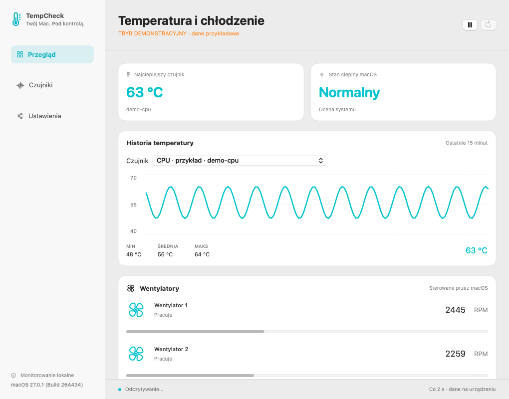

# TempCheck

Natywny monitor temperatur i prędkości wentylatorów dla Maca. SwiftUI + AppKit,
pasek menu, systemowy jasny i ciemny wygląd. Interfejs po polsku.



## Funkcje wersji 0.1

- Temperatury dostępnych czujników SMC; grupy CPU, GPU i baterii dla rozpoznanych kluczy.
- Aktualne RPM każdego wentylatora; zero RPM pozostaje odróżnione od braku danych.
- Odczyt najcieplejszego dostępnego czujnika w pasku menu; stan cieplny macOS.
- Historia ostatnich 15 minut w pamięci, wykres wybranego czujnika i min./średnia/maks.
- Jednostki °C/°F, odświeżanie co 1/2/5/10 sekund, pauza i ręczne odświeżenie.
- Eksport temperatur i RPM do CSV; brakujące wartości jako puste pola.
- Pomiary w tle, wstrzymanie podczas uśpienia, ponowne połączenie po utracie SMC.
- Brak ruchu sieciowego i zewnętrznych bibliotek. Wyłącznie odczyt sprzętu.

Zamknięcie okna pozostawia monitor w pasku menu. Zakończenie: menu TempCheck →
„Zamknij TempCheck” albo ⌘Q.

## Uruchomienie i budowanie

Gotowa paczka `TempCheck-macOS.zip` zawiera `TempCheck.app`. Rozpakuj i uruchom
aplikację. Możesz przenieść ją do folderu Aplikacje. Paczka testowa ma podpis
lokalny ad hoc; nie jest podpisana certyfikatem Developer ID ani notaryzowana.

Do budowania potrzebne są macOS, Xcode i Swift 5.9 lub nowszy. Sprawdzony zestaw:
macOS 27.0.1, Xcode z SDK 27, Swift 6.4.

```sh
swift test
swift run TempCheck
swift run TempCheck --diagnose
```

Pakowanie aplikacji dla Intel i Apple Silicon:

```sh
./scripts/build-app.sh
# Tylko architektura bieżącego komputera:
./scripts/build-app.sh --native
```

Wynik trafia do `dist/`. Można ustawić `TEMPCHECK_BUILD_ROOT` oraz
`TEMPCHECK_OUTPUT_DIR`, aby wskazać inne katalogi budowania i wyników.
Skrypt korzysta z silnika SwiftPM `native`, dostępnego również w starszych
toolchainach; Swift 6.4 zgłasza jego wycofywanie. Zwykłe `swift build` i `swift test`
zostały również sprawdzone z domyślnym silnikiem Swift 6.4.

Przykładowe dane do demonstracji wyglądu:

```sh
swift run TempCheck --demo
```

Ten tryb jest jawnie oznaczony w oknie i pasku menu. Nie uruchamia się automatycznie
w razie braku dostępu do czujników.

## Zakres zgodności

Docelowe minimum: **macOS 12**. Paczka zawiera **arm64 i x86_64**.
Sprawdzono rzeczywiste odczyty na bieżącym Macu Apple Silicon z macOS 27.0.1.
Starsze systemy i fizyczny Mac Intel wymagają osobnych testów sprzętowych.

SMC nie jest stabilnym, publicznie udokumentowanym API temperatur Apple. Dostępność
czujników zależy od modelu i systemu. Nie obiecujemy działania na każdej wersji
macOS ani na przyszłych modelach. Brak danych powoduje komunikat i „—”, nigdy
zastępcze zero. Aplikacji nie należy uruchamiać z `sudo`.

Klucze nierozpoznanych czujników pozostają widoczne. Apple Silicon grupuje strefy
Tp/Te jako CPU i Tg jako GPU zgodnie z konwencjami społeczności, z zachowaniem
surowego identyfikatora; nie przypisuje im numerów fizycznych rdzeni. Rodzina Tf
zawiera zarówno CPU, jak i GPU, dlatego rozpoznawane są konkretne klucze.
Nie każdy czujnik jest pojedynczym rdzeniem i nie każda temperatura opisuje obudowę.

`FNum = 0` oznacza, że SMC zgłasza brak wentylatorów. Nieudany odczyt `FNum`
oznacza brak informacji. `0 RPM` oznacza poprawnie odczytany zatrzymany wentylator.
Zakres odczytów temperatur w tej wersji jest ograniczony do (0, 150] °C;
nieaktywne kanały i wartości poza zakresem są traktowane jako niedostępne.

## Rozwój projektu

- [Plan funkcji i etapów](docs/PLAN.md)
- [Postęp, testy i następne zadanie](docs/PROGRESS.md)
- [Zasady rozwoju](docs/DEVELOPMENT.md)

## Źródła techniczne

- [Apple: ProcessInfo.thermalState](https://developer.apple.com/documentation/foundation/processinfo/thermalstate-swift.property) — ocena stanu cieplnego przez system.
- [Stats: interfejs AppleSMC](https://github.com/exelban/stats/blob/master/SMC/smc.swift) — odniesienie do protokołu i formatów danych.
- [Stats: identyfikatory czujników](https://github.com/exelban/stats/blob/master/Modules/Sensors/values.swift) — konwencje nazw stref; lokalizacja może zmieniać się między modelami.

TempCheck ma własną małą implementację mostu w C. Nie dołącza kodu aplikacji Stats
ani funkcji zapisu do SMC.
